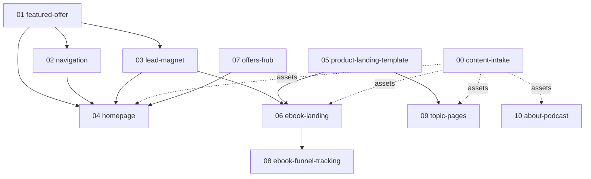

# Areas — web redesign (epic index)

Decomposition of [spec.md](spec.md). Each area gets its own
`.aiwork/<date>_<slug>/` spec when its turn comes; this file fixes scope,
boundaries and order only.

## Dependency graph

Waves: **1** = 00 (human, starts now) + 01 + 05 · **2** = 02, 03, 06, 07 ·
**3** = 04, 08 · **4** = 09, 10.

Christmas 2026 is the forcing date: the e-book sells now. If time is short,
ship 01 → 03 → 06 → 08 first (bar, pop-up, landing, funnel), then the rest.

---

## 00 — Content intake (human)

**Status:** not-started
Assets only the client can provide. Tracked here so areas do not stall
silently.

- **Deliverables:** portrait and event photos of Zdeňka and the team; a
  60–120 s phone video for the e-book page; 3–6 testimonials with name,
  role and permission (doctor, parents, special educator); media list with
  article links (ČT24, iDNES, Český rozhlas, Deník N, Věda 24, …); numbers
  for proof (families helped, years, buyers); the desatero PDF;
  confirmation of nav labels and section copy.
- **Depends on:** nothing.
- **Verify:** assets in Directus files, list checked off in the area spec
  that needs them.

## 01 — Featured offer + notification bar

**Status:** not-started
One Directus singleton (or collection with an active window) describing
the current offer: label, short pitch, price, target URL, nav-button text,
active from/to. Drives a dismissible top bar on every page and the
highlighted nav button. Empty → nothing renders.

- **Deliverables:** Directus schema + permissions (snapshot committed),
  typed fetch, `TopBar` component in the default and homepage layouts.
- **Depends on:** nothing.
- **Verify:** swap the offer in Directus, bar and button change without a
  deploy; 375 px layout; bar hidden after dismiss for the session.

## 02 — Navigation

**Status:** not-started
New main nav: „Pro rodiče" dropdown (Moje dítě nejí / Moje dítě má
nadváhu / Prevence, each with a one-line hint), „Kurzy a e-booky",
Podcast, O nás, Kontakt, featured-offer button (01). „Pro odborníky" and
social icons move to the top bar. Mobile menu equivalent.

- **Deliverables:** reworked `MainNav.vue` / `Header.vue`, keyboard and
  touch accessible dropdown, redirects for any renamed routes.
- **Depends on:** 01 (button), 07 (route for „Kurzy a e-booky").
- **Verify:** desktop + 375 px, keyboard navigation, no broken links
  (crawl).

## 03 — Lead magnet: desatero + pop-up

**Status:** not-started
Free „Cukrovíčkové desatero" (or the current offer's taster) delivered by
e-mail in exchange for name + e-mail. Entry points: timed/idle pop-up,
newsletter block, landing-page fallback CTA („Ještě váháte?"). Reuses the
newsletter form plumbing (`composables/forms`), tags the source.

- **Deliverables:** pop-up with frequency cap and no-show on checkout and
  auth pages, form variant, delivery (e-mail with PDF link), consent text.
- **Depends on:** 01 (which magnet is current), 00 (PDF).
- **Verify:** signup lands in the list with the right tag, PDF arrives,
  pop-up does not fight the cookie bar, 375 px.

## 04 — Homepage

**Status:** not-started
Rebuild `(homepage)/index.vue` after the homepage prototype: hero with Zdeňka's photo and two CTAs („S čím
potřebujete pomoc?", the offer) + „Znáte nás z" media strip; featured-offer
band; problem router (3 cards → topic pages); offer grid (from 07);
testimonials with numbers; „Víme, jaké to je" about block; newsletter +
podcast block. Retire homepage sections that no longer fit.

- **Depends on:** 01, 02, 03, 07; 00 for photos, testimonials, media.
- **Verify:** `verify` skill on desktop + 375 px, Lighthouse not worse
  than today, every CTA reaches its target.

## 05 — Product landing template

**Status:** not-started
Reusable section components for selling one product, so the e-book,
webinars and Live Courses share structure: hero with cover + price + CTA
and a one-line proof quote, media strip, pain-point grid („Znáte to?"),
outcomes + video, contents, tabbed „tips by age", reviews (2–3 + „more"),
author medallion, what-you-get + bonus box, FAQ, final CTA with lead-magnet
fallback. Sticky mobile buy button.

- **Deliverables:** components in the right layer (check `fallow guard`),
  a style-page entry, no product-specific copy inside components.
- **Depends on:** nothing.
- **Verify:** components render on `style.vue` at desktop + 375 px.

## 06 — E-book landing: Cukroví s dětmi v pohodě

**Status:** not-started
Rewrite `ebook-vanocni-cukrovi.vue` on the 05 template with the prototype
copy. Copy goes through `writing:czech-typography`
and the client's approval.

- **Depends on:** 05, 03; 00 for video, reviews, media; spec decision on
  checkout (SimpleShop vs. our shop).
- **Verify:** `verify` skill; buy button reaches checkout; Christmas
  deadline.

## 07 — Offers hub: „Kurzy a e-booky"

**Status:** not-started
One page listing current e-books, online courses, webinars and
consultations, paid and free, as cards (type badge, title, teaser, price,
detail link). Must coexist with
the shop catalog at `/kurzy`: decide in the area spec whether it extends
that catalog or is a separate marketing list that includes it.

- **Depends on:** nothing (content source decided in its spec).
- **Verify:** every live offer appears once with the right link; empty
  states.

## 08 — E-book funnel tracking

**Status:** not-started
Extend the Meta Pixel events (`../2026-09-09_meta-pixel/`) to the e-book:
`ViewContent` on the landing, `InitiateCheckout` on the buy button,
`Purchase` after payment. Settle with the marketer whether SimpleShop's own
pixel field is used or the existing thank-you-redirect pattern. If the
e-book moves to our checkout, `Purchase` comes from the order instead.

- **Depends on:** 06, checkout decision.
- **Verify:** Meta Events Manager shows each event once per action, with
  consent only; a test purchase.

## 09 — Topic pages: nejí / nadváha / prevence

**Status:** not-started
Restructure `nejedlik.vue`, `nadvaha.vue`, `prevence.vue` (and the old
`pro-rodice.vue` hub) for a parent in a hurry: short recognition section,
what helps, the relevant products and free materials, then the expert text
below the fold or condensed. Authors review every copy change.

- **Depends on:** 05 (sections), 02 (routes); 00 for approved copy.
- **Verify:** `verify` skill; each page links to at least one product and
  one free material.

## 10 — About + podcast

**Status:** not-started
„O nás" split into scannable blocks (story, numbers, team, media
appearances with links) and a podcast page/section with one-click Spotify
playback. No paid tier (non-goal).

- **Depends on:** 00 for photos, media links.
- **Verify:** `verify` skill; Spotify embed respects cookie consent.
