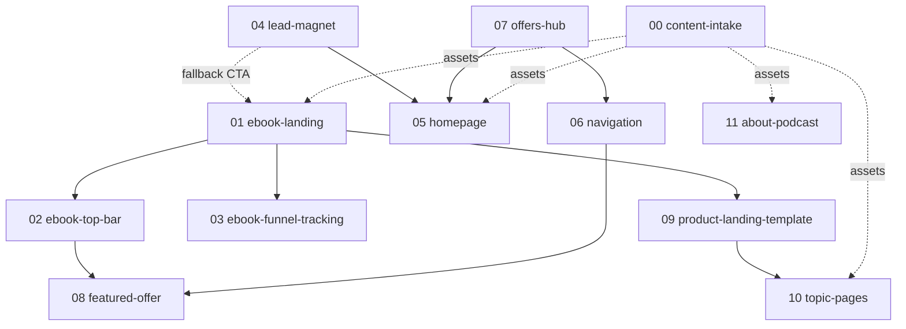

# Areas — web redesign (epic index)

Decomposition of [spec.md](spec.md). Each area gets its own
`.aiwork/<date>_<slug>/` spec when its turn comes; this file fixes scope,
boundaries and order only.

Renumbered 2026-11-05 by priority. Rule: **specific first, generic only
once repetition shows.** The e-book is built as its own page; shared
components, a Directus-driven offer and the landing template are extracted
later, when a second page needs them.

## Priority order

1. **E-book**: 01 landing (live 9. 11. 2026) → 02 top bar + menu link →
   03 funnel tracking → 04 desatero lead magnet.
2. **Homepage**: 05, then 06 navigation and 07 offers hub it links to.
3. **Rest**: 08 featured offer in Directus, 09 landing template, 10 topic
   pages, 11 about + podcast.

00 (client content) runs alongside everything.

Old numbers (spec of 2026-10-20): 06→01, 01→02 (e-book only) and 08
(generic), 08→03, 03→04, 04→05, 02→06, 07→07, 05→09, 09→10, 10→11.

---

## 00 — Content intake (human)

**Status:** in-progress (Lukas confirms claims with Zdeňka)
Assets only the client can provide. Missing assets never block a launch:
the section that needs one does not render until it arrives.

- **E-book (01, needed in the days after 9. 11.):** the e-book PDF (for
  „Nahlédněte dovnitř" previews and the page count), the final author
  photo, Zdeňka's 60–120 s phone video, the desatero PDF, confirmation of
  the prototype claims listed in the 01 spec.
- **Later:** portrait and event photos of the team; 2–3 new testimonials
  with name, role and permission; media list with article links (ČT24,
  iDNES, Český rozhlas, Deník N, …); numbers for proof (families helped,
  years, buyers); nav labels and section copy.
- **Verify:** assets committed or in Directus, checked off in the area
  spec that needs them.

## 01 — E-book landing: Cukroví s dětmi a v pohodě

**Status:** in-progress → `../2026-11-05_ebook-landing/`
Rewrite `ebook-vanocni-cukrovi.vue` after the prototype
(`docs/prototype-ebook.txt`, source in `/tmp/jedlik-nejedlik-prototypes/`), merging its copy with last year's page.
Specific to this product: no generic template. Checkout stays SimpleShop
(`gN5Qq`) this season. Go-live **Monday 9. 11. 2026**.

- **Depends on:** nothing for launch; 00 for the video, previews, photo.
- **Verify:** `verify` skill desktop + 375 px; buy button reaches
  SimpleShop and fires `InitiateCheckout`.

## 02 — E-book top bar + menu link

**Status:** not-started
A top bar on every page („Vánoční e-book Cukroví s dětmi · 290 Kč · Chci
e-book →"), hardcoded for the e-book and dismissible for the session, and
a visible link to the e-book in the current menu. Not the new navigation
(06), not Directus-driven (08). Ships with 01 if time allows.

- **Depends on:** 01 (target page).
- **Verify:** desktop + 375 px, dismiss persists for the session, bar does
  not fight the cookie banner.

## 03 — E-book funnel tracking

**Status:** not-started
Meta funnel for the e-book on SimpleShop: `ViewContent` on the landing,
`InitiateCheckout` on the buy button (pattern from
`../2026-09-09_meta-pixel/`), `Purchase`. The e-book must keep SimpleShop's
own post-payment page (its download lives there), so the thank-you
redirect pattern does not apply; settle with the marketer whether
SimpleShop's own pixel field is used for `Purchase`.

- **Depends on:** 01.
- **Verify:** Meta Events Manager shows each event once per action, with
  consent only; a test purchase.

## 04 — Lead magnet: desatero + pop-up

**Status:** done (pop-up shipped, no source tag by decision; see ../2026-11-05_desatero-popup/spec.md)
Free „Cukrovíčkové desatero" delivered by e-mail for name + e-mail.
Entry points: the „Ještě váháte?" block on 01, a timed/idle pop-up,
newsletter block. Reuses the newsletter form plumbing
(`composables/forms`), tags the source.

- **Depends on:** 00 (desatero PDF).
- **Verify:** signup lands in the list with the right tag, PDF arrives,
  pop-up has a frequency cap, skips checkout and auth pages, does not
  fight the cookie bar, 375 px.

## 05 — Homepage

**Status:** in-progress → `../2026-11-05_homepage/`
Rebuild `(homepage)/index.vue` after `docs/prototype-homepage.txt` (source in `/tmp/jedlik-nejedlik-prototypes/`): hero with
Zdeňka's photo and two CTAs, „Znáte nás z" media strip, current-offer band,
problem router (3 cards → topic pages), offer grid, testimonials with
numbers, „Víme, jaké to je" about block, newsletter + podcast. Hardcode
what the homepage alone uses; extract only what 01 already has.

- **Depends on:** 04 (newsletter/desatero block), 07 (offer grid
  target); 00 for photos, testimonials, media.
- **Verify:** `verify` skill desktop + 375 px, Lighthouse not worse than
  today, every CTA reaches its target.

## 06 — Navigation

**Status:** not-started
„Pro rodiče" dropdown (Moje dítě nejí / Moje dítě má nadváhu / Prevence),
„Kurzy a e-booky", Podcast, O nás, Kontakt, highlighted offer button.
„Pro odborníky" and social icons move to the top bar. Mobile equivalent.

- **Depends on:** 07 (route for „Kurzy a e-booky"), 02 (top bar).
- **Verify:** desktop + 375 px, keyboard navigation, no broken links.

## 07 — Offers hub: „Kurzy a e-booky"

**Status:** not-started
One page listing current e-books, courses, webinars and consultations,
paid and free, as cards. Decide in its spec whether it extends the shop
catalog at `/kurzy` or is a marketing list that includes it.

- **Depends on:** nothing.
- **Verify:** every live offer appears once with the right link; empty
  states.

## 08 — Featured offer in Directus

**Status:** not-started
Generalise 02 once the season's offer changes for the first time (after
Christmas): one Directus record (label, pitch, price, URL, nav-button text,
active from/to) drives the top bar, the nav button and the homepage band.
Swap without a deploy.

- **Depends on:** 02, 06.
- **Verify:** swap the offer in Directus, bar and button change without a
  deploy.

## 09 — Product landing template

**Status:** not-started
Extract the sections of 01 into reusable components when a second product
page (webinar, Live Course) needs them. Not before.

- **Depends on:** 01 and a second product page.
- **Verify:** both pages render unchanged; style-page entry.

## 10 — Topic pages: nejí / nadváha / prevence

**Status:** not-started
Restructure `nejedlik.vue`, `nadvaha.vue`, `prevence.vue` (and
`pro-rodice.vue`) for a parent in a hurry: recognition, what helps, the
relevant products and free materials, expert text condensed or below the
fold. Authors review every copy change.

- **Depends on:** 06 (routes); 00 for approved copy.
- **Verify:** `verify` skill; each page links to at least one product and
  one free material.

## 11 — About + podcast

**Status:** not-started
„O nás" split into scannable blocks (story, numbers, team, media
appearances linking to the articles) and a podcast section with one-click
Spotify playback. The O nás story may be tightened with AI, approved by
Zdeňka. No paid tier.

- **Depends on:** 00 for photos, media links.
- **Verify:** `verify` skill; Spotify embed respects cookie consent.

## Parked

- Review counter and „more reviews" („koupilo 27 lidí"): needs a buyer
  count source (SimpleShop export or our orders). Revisit with 09.
- Audio version of the e-book, paid podcast tier: spec non-goals.
- E-book on our own checkout instead of SimpleShop: after Christmas.
